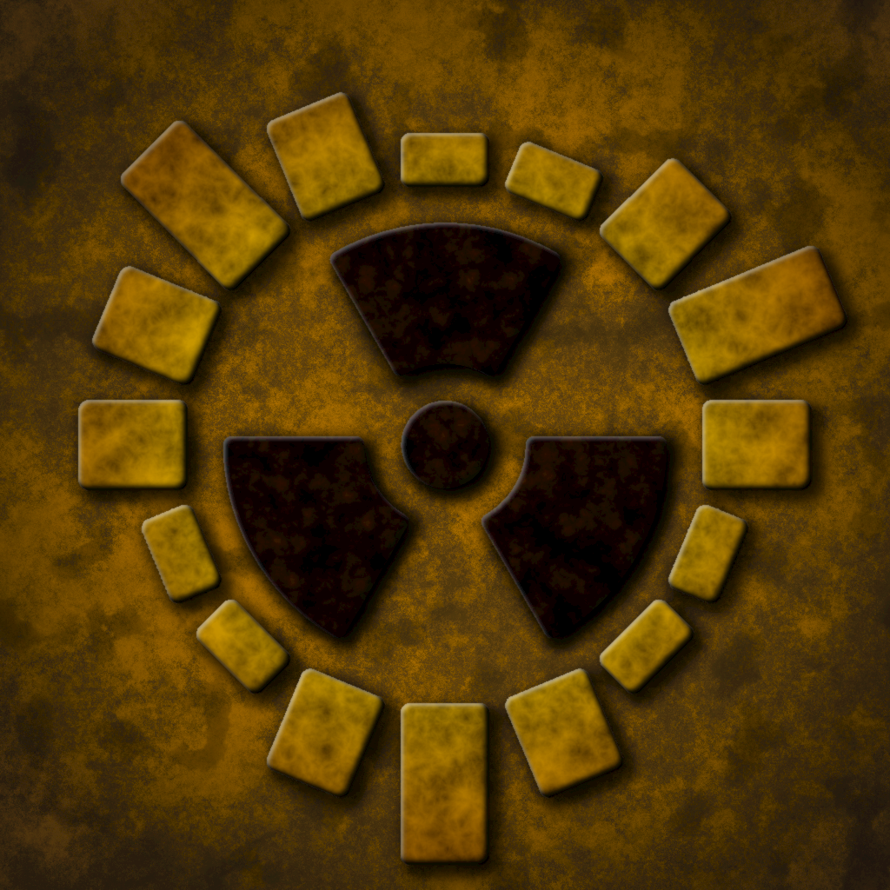

# DESCRIPTION

A small mod for S.T.A.L.K.E.R. Anomaly that disables the background music when the player enters the territory of any factions and turns it back on when the player continues to explore the zone. It also has additional features:

+ Ambient is disabled by certain weather conditions. By default, it is disabled for rainy and stormy weather.

+ The Blowout and Psy-Storm also disable background music (including some other events, see Compatibility).

+ Ability to disable ambient sounds for each location (only weather).

NOTE: The mod is in beta testing.

# REQUIREMENTS

There are no dependencies. The mod was tested on S.T.A.L.K.E.R. Anomaly 1.5.3

# INSTALLATION

MO2 is recommended. Settings are available in MCM and in the internal configuration file. MCM is not required.

# COMPATIBILITY

It is fully compatible with the following mods:

+ [Enhanced Dynamic (Combat) Music (Update 2)](https://www.moddb.com/mods/stalker-anomaly/addons/enhanced-dynamic-combat-music)

+ [RE:D Moon](https://www.moddb.com/mods/stalker-anomaly/addons/red-moon)

# BUILDING

The build process requires Python to be installed. It is recommended to use the latest version (3.x.x). To start the build, run the `build.py` script.

# SUPPORT

If you’d like to support me, you can find the details on my main GitHub page.

# DESCRIPTION

A small mod for S.T.A.L.K.E.R. Anomaly that disables the background music when the player enters the territory of any factions and turns it back on when the player continues to explore the zone. It also has additional features:

+ Ambient is disabled by certain weather conditions. By default, it is disabled for rainy and stormy weather.

+ The Blowout and Psy-Storm also disable background music (including some other events, see Compatibility).

+ Ability to disable ambient sounds for each location (only weather).

NOTE: The mod is in beta testing.

# DESCRIPTION
# DESCRIPTION

A small mod for S.T.A.L.K.E.R. Anomaly that disables the background music when the player enters the territory of any factions and turns it back on when the player continues to explore the zone. It also has additional features:
A small mod for S.T.A.L.K.E.R. Anomaly that disables the background music when the player enters the territory of any factions and turns it back on when the player continues to explore the zone. It also has additional features:.T.A.L.K.E.R. Anomaly that disables the background music when the player enters the territory of any factions and turns it back on when the player continues to explore the zone. It also has additional features:

+ Ambient is disabled by certain weather conditions. By default, it is disabled for rainy and stormy weather.

+ The Blowout and Psy-Storm also disable background music (including some other events, see Compatibility).

+ Ability to disable ambient sounds for each location (only weather).

+ Ambient is disabled by certain weather conditions. By default, it is disabled for rainy and stormy weather.

+ Ambient is disabled by certain weather conditions. By default, it is disabled for rainy and stormy weather.
Ambient is disabled by certain weather conditions. By default, it is disabled for rainy and stormy weather.. By default, it is disabled for rainy and stormy weather.

+ The Blowout and Psy-Storm also disable background music (including some other events, see Compatibility).

+ The Blowout and Psy-Storm also disable background music (including some other events, see Compatibility).
The Blowout and Psy-Storm also disable background music (including some other events, see Compatibility).-Storm also disable background music (including some other events, see Compatibility).

+ Ability to disable ambient sounds for each location (only weather).

+ Ability to disable ambient sounds for each location (only weather).
Ability to disable ambient sounds for each location (only weather).(only weather).

NOTE: The mod is in beta testing.
NOTE: The mod is in beta testing.: The mod is in beta testing.

# REQUIREMENTS

There are no dependencies. The mod was tested on S.T.A.L.K.E.R. Anomaly 1.5.3

# REQUIREMENTS
# REQUIREMENTS

There are no dependencies. The mod was tested on S.T.A.L.K.E.R. Anomaly 1.5.3
There are no dependencies. The mod was tested on S.T.A.L.K.E.R. Anomaly 1.5.3. The mod was tested on S.T.A.L.K.E.R. Anomaly 1.5.3

# INSTALLATION

MO2 is recommended. Settings are available in MCM and in the internal configuration file. MCM is not required.

# INSTALLATION
# INSTALLATION

MO2 is recommended. Settings are available in MCM and in the internal configuration file. MCM is not required.
MO2 is recommended. Settings are available in MCM and in the internal configuration file. MCM is not required.. Settings are available in MCM and in the internal configuration file. MCM is not required.

# COMPATIBILITY

It is fully compatible with the following mods:

+ [Enhanced Dynamic (Combat) Music (Update 2)](https://www.moddb.com/mods/stalker-anomaly/addons/enhanced-dynamic-combat-music)

+ [RE:D Moon](https://www.moddb.com/mods/stalker-anomaly/addons/red-moon)

# COMPATIBILITY
# COMPATIBILITY

It is fully compatible with the following mods:
It is fully compatible with the following mods::

+ [Enhanced Dynamic (Combat) Music (Update 2)](https://www.moddb.com/mods/stalker-anomaly/addons/enhanced-dynamic-combat-music)

+ [RE:D Moon](https://www.moddb.com/mods/stalker-anomaly/addons/red-moon)

+ [Enhanced Dynamic (Combat) Music (Update 2)](https://www.moddb.com/mods/stalker-anomaly/addons/enhanced-dynamic-combat-music)

+ [Enhanced Dynamic (Combat) Music (Update 2)](https://www.moddb.com/mods/stalker-anomaly/addons/enhanced-dynamic-combat-music)
[Enhanced Dynamic (Combat) Music (Update 2)](https://www.moddb.com/mods/stalker-anomaly/addons/enhanced-dynamic-combat-music)[Enhanced Dynamic (Combat) Music (Update 2)](https://www.moddb.com/mods/stalker-anomaly/addons/enhanced-dynamic-combat-music)

+ [RE:D Moon](https://www.moddb.com/mods/stalker-anomaly/addons/red-moon)

+ [RE:D Moon](https://www.moddb.com/mods/stalker-anomaly/addons/red-moon)
[RE:D Moon](https://www.moddb.com/mods/stalker-anomaly/addons/red-moon)[RE:D Moon](https://www.moddb.com/mods/stalker-anomaly/addons/red-moon)

# BUILDING

The build process requires Python to be installed. It is recommended to use the latest version (3.x.x). To start the build, run the `build.py` script.

# BUILDING
# BUILDING

The build process requires Python to be installed. It is recommended to use the latest version (3.x.x). To start the build, run the `build.py` script.
The build process requires Python to be installed. It is recommended to use the latest version (3.x.x). To start the build, run the `build.py` script.. It is recommended to use the latest version (3.x.x). To start the build, run the `build.py` script.

# SUPPORT

If you’d like to support me, you can find the details on my main GitHub page.

# SUPPORT
# SUPPORT

If you’d like to support me, you can find the details on my main GitHub page.
If you’d like to support me, you can find the details on my main GitHub page., you can find the details on my main GitHub page.

